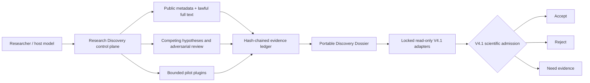

# Research Discovery V1.0.1

This evidence-bound Codex Skill helps researchers find and test research
questions. It records public searches and lawful full text, competing
explanations, preregistered bounded pilots, negative results and a portable
handoff to CS Nature Paper V4.1. A search never proves originality, and a pilot
never becomes a formal experiment by itself.



The control plane preserves provenance, budgets, failures and negative results.
The dossier can be moved and independently verified. V4.1 retains authority
over novelty, feasibility, protocol, statistics and publication sufficiency.

```powershell
cd C:\Users\17271\.codex\skills\research-discovery
python scripts/discovery.py doctor
python scripts/discovery.py init projects\demo --domain "software measurement"
python scripts/discovery.py mine examples\seed.json --output projects\demo\opportunities.json
python scripts/discovery.py registry C:\Users\17271\.codex\skills --output projects\demo\capabilities.json
python scripts/discovery.py runtime-capabilities
python scripts/discovery.py search projects\demo --provider crossref --query "reproducible Python package builds" --public
python -m unittest discover -s tests -v
```

For three candidates, create a JSON list following `references/contracts.md` and
run `admit`. Export with `export`; verify with `validate` and inspect
`handoff_to_v4_1.md`. A search needs `--public`, uses only an allow-listed
provider and stores a metadata-only envelope. Configure a real contact address
for Crossref outside this repository if its polite-pool policy requires it.

For a host-generated frontier packet, use `hypotheses-request`. The response
must contain the request hash, actual actor/model, artifact IDs and at least
three materially distinct candidates. It is recorded as
`HOST_GENERATED_REQUIRES_ADMISSION`; it is not automatically admitted as
science.

Full-text retrieval requires a lawful access basis and an HTTPS URL on the
explicit arXiv/PMC allowlist. `fulltext-verify` records an exact line range,
quote, relation, checker and source hash. Abstracts and metadata remain
`METADATA_ONLY`.

The built-in `text_delta` plugin is a bounded non-CSV pilot. Register a JSON
protocol with `plugin-register`, then execute it with `plugin-run`. Its inputs
are content-addressed text evidence and its output and failures are retained
as evidence.

`export` embeds small evidence artifacts in a content-addressed `evidence/`
directory. Larger artifacts require a stable HTTPS origin and are marked
`STABLE_REFERENCE_REQUIRED`; missing or changed evidence makes `validate`
fail. Moving the complete dossier to another directory therefore preserves
the validation root.

`examples/dossier/` is a generated synthetic handoff showing three competing
routes and a retained negative pilot. Its result is deliberately exploratory.

The bundled runners use only the Python standard library and resource
governors. They are not security sandboxes; never execute untrusted packages
or source files.

The private ecosystem and API audit that supports adoption decisions is kept
outside this distributable repository at `E:\final\research-discovery-audit`.
