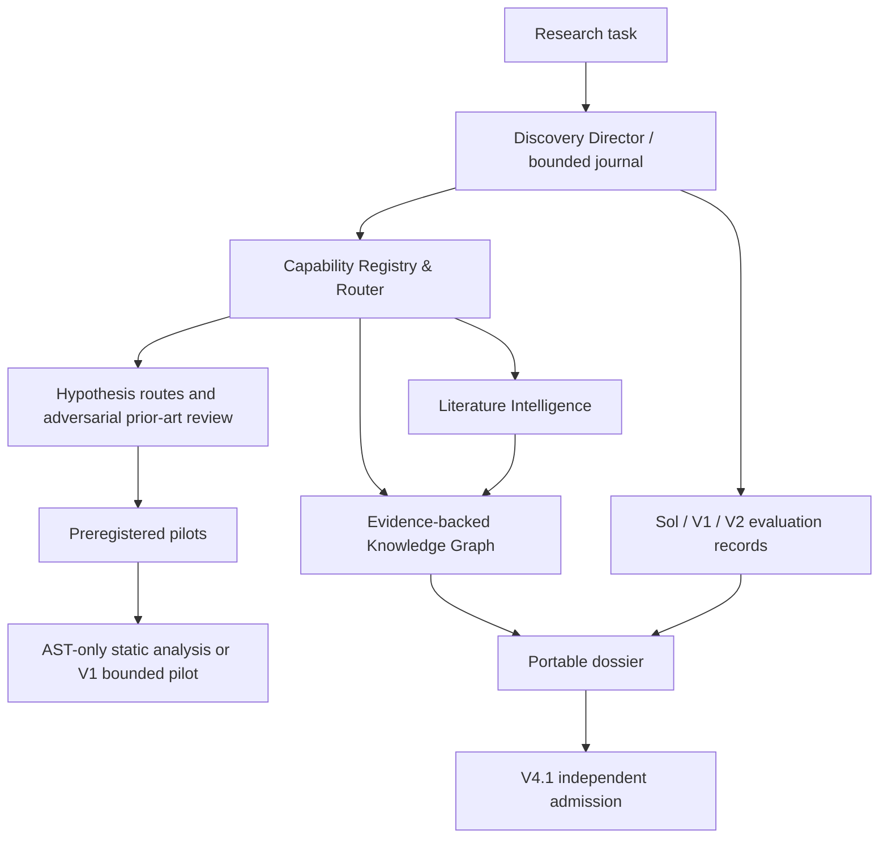

# Research Discovery V2.0 Architecture

The journal and evidence ledger remain the source of integrity. The graph
stores claims and relationships with evidence IDs. The router chooses an
available, permission-compatible provider but has no scientific truth
authority. Pilot outputs remain exploratory and are never copied into formal
V4.1 samples automatically.
